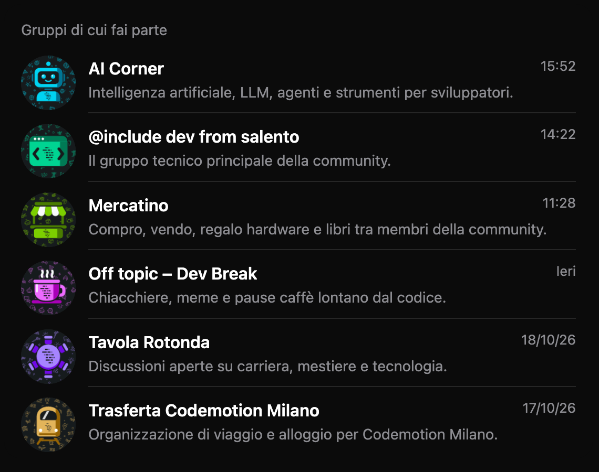

# Salento.dev · brand

**Design system as code** della community [Salento.dev](https://salento.dev): le grafiche della community sono generate da dati YAML versionati, con gli stessi colori del sito.

**Fase 1:** icone dei gruppi della WhatsApp Community (640×640, ritagliate a cerchio).



Ogni icona: sfondo mist-900, **wallpaper di doodle a schizzo** nell'accento del gruppo, **soggetto flat** al centro con il logo a barre stampato sopra, nessun testo. Ogni gruppo permanente ha il suo accento (`cyan`, `violet`, `fuchsia`, `emerald`, `lime`); i temporanei sono sempre **pietra**.

## Quickstart

Richiede Node 22 (`nvm use`).

```bash
npm install
npm run validate
npm run generate
npm run gallery     # apri out/index.html
```

## Comandi

| Comando | Cosa fa |
|---------|---------|
| `npm run schema` | Esporta `schema/group.schema.json` da `src/schema.js` |
| `npm run validate` | Schema e regole incrociate, soggetti (lint + cerchio sicuro), doodle e `sets.yaml`, contrasto per ogni accento, schema aggiornato; avvisa sugli accenti ripetuti |
| `npm run generate` | Genera `out/groups/<slug>.png` (+ `out/groups/96/`). Opzioni: `--only <file…>`, `--include-archived` |
| `npm run gallery` | Crea `out/index.html` (lista chat simulata, 640 ritagliata a cerchio, 96/48px, download, archiviati) |
| `npm run check-expired` | Elenca i temporanei terminati ma ancora `active` (`--markdown`, `--today AAAA-MM-GG`) |
| `npm test` | Test con `node:test` |

## Struttura

```
tokens/tokens.json            token W3C DTCG (primitive → semantic, group.accents, placeholder)
schema/group.schema.json      generato da src/schema.js (zod)
content/groups/*.yaml         un file per gruppo, slug = nome file
assets/subjects/*.svg         soggetti flat, disegnati con 4 colori segnaposto
assets/doodles/*.svg          libreria di doodle del wallpaper (+ sets.yaml, README con le regole)
assets/logo.svg               logo ufficiale (dal sito)
formats/icon.js               formato icona (auto-scoperto)
src/                          libreria (token, colori, schema, soggetti, doodle, wallpaper, render)
scripts/                      comandi npm
test/                         node:test
docs/                         documentazione (italiano) e ADR
```

## Documentazione

- [Indice docs](docs/README.md) · [Contribuire](CONTRIBUTING.md) · [ADR](docs/04_decisioni_architetturali/README.md) · [Domande aperte](docs/open-questions.md)

## Roadmap

- **Fase 1 — icone gruppi WhatsApp** (questa)
- **Fase 2 — cover eventi**: nuova collezione `content/events/` e formato `formats/event-cover.js`, riusando token e libreria.
- In seguito: storie/post social, immagini Open Graph, integrazione con il sito.

## Licenza

Codice sotto [MIT](LICENSE); asset grafici (soggetti, doodle, logo, token e immagini generate) sotto [CC BY 4.0](LICENSE-ASSETS.md).
